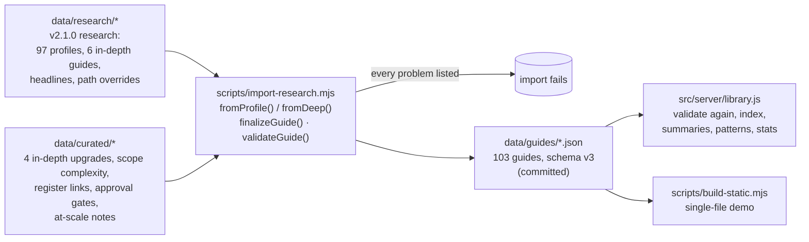

# Architecture

## Constraints that shaped it

1. **Start with one command.** `npm start` on a fresh clone, no install and no build: a dependency-free Node server and ES modules served as-is. Dev tools (esbuild for the demo file, Playwright for browser tests) are optional.
2. **One format, one code path.** Researched, generated and shared guides render through the same view, export through the same Markdown function and validate against the same schema. The modules that define the format live in `public/shared/` and run in the browser, on the server and in the scripts.
3. **The data is the product.** It is edited by people and produced by models, so it is validated loudly at import and at start-up, and model output is treated as untrusted input.
4. **Strict security for a page that renders untrusted text.** No inline code, a CSP with Trusted Types, one HTML sink that escapes by default, and an SSRF guard on the only feature that makes outbound requests from user input.

## Data pipeline



`npm run data:check` (and a unit test) fails if `data/guides` is out of date with its inputs.

## Guide schema v3 (abridged)

```text
id, name, category, website, tagline, kind (in-depth | researched | generated), featured,
lastChecked, confidence (High | Medium | Low), path (self | review | partner | key | none),
verdict, needGuide,
auth        { model, detail, userOAuth, access }
effort      { difficulty (Easy | Moderate | Complex | N/A), researchRating, timeToFirstTest,
              timeToProduction, firstShort, prodShort, prodDays }
approval    { required (true | false | null), kind, gate, when, timeline[], recurring, atScale?,
              unconfirmed? (true on generated guides with no vendor family behind them) }
scopes      { complexity (Low | Medium | High | N/A), why, summary, table[] }
cost, tiers[], prerequisites[], registerAt { url, path },
phases[]    { name, duration, gate? (required | optional), steps[] { do, who, agent } }
roles       { team, console, customer, consoleRoles[] }
customerExperience[], testing[], blockers[] { problem, fix }, gotchas[],
automation  { agentCan, humanMust }, uncertain[], sources[] { url, label },
generation  { engine, engineLabel, model, input, intent, generatedAt, evidence[], verify[],
              vendorEmail, similar[], durationMs }          (generated guides only)
```

Derived fields (`effort.difficulty`, `effort.prodDays`, `approval.required`, `approval.kind`) are computed by `finalizeGuide()` in `guide-model.js` and never typed by hand.

## The Live Generator

### Event protocol

`POST /api/generate` streams Server-Sent Events. Both engines emit the same protocol, so the UI doesn't care which one ran:

| Event | Payload | Meaning |
|---|---|---|
| `run` | `engine { kind, label, model? }`, `stages[] { id, label }`, `input` | A run started. A second `run` means the live agent fell back to the offline engine |
| `stage` | `id`, `status` (running, done, warn, skipped, error), `summary?` | A stage changed |
| `log` | `stage`, `level` (info, success, warn, error), `text` | A line for the agent log |
| `evidence` | `item { kind, label, detail, url? }` | Something the agent checked (also stored on the guide) |
| `guide` | `guide`, `matched`, `shareId?`, `cached?` | The result. `matched` = researched guide from the library |
| `error` | `code`, `message` | The run failed |
| `done` | `ms` | The stream is complete |

### Decision order (cheapest first)

1. **Library hit** (name, alias, vendor URL or bare domain) → stream the researched guide. Free, not rate limited.
2. **Cache hit** (same engine, intent and input within 24 h; case, scheme, `www.` and a trailing slash are ignored) → replay the stored guide. Free. A live run that fell back to the offline engine is not cached, so the next request tries the live agent again.
3. **Concurrency gate** (503 when full, checked first so a busy server doesn't spend the caller's quota), then the **per-client rate limit** (429), then the engine:
   - **Live** (API key set): identify → discovery probe → Claude with web search (streamed; `pause_turn` resumed by sending the assistant content back unchanged; one nudge if it ends without calling `submit_guide`) → convert with `fromProfile()` → `sanitizeGuide()` → `finalizeGuide()` → `validateGuide()` → cap confidence at Medium. Any failure falls back to the offline engine in the same stream, reusing the probe result.
   - **Offline**: identify → discovery probe → scope analysis → path and approval → draft → validate.
4. **Store** the generated guide (`/g/<12-char id>`, 72 random bits) and remember it in the cache.

### Offline engine evidence, in order of strength

1. The library itself (exact match: stop).
2. A vendor family that shares a researched app's developer platform (Zoho, Atlassian, Google, Microsoft, Salesforce, Intuit, Meta).
3. OAuth discovery metadata on the domain the user gave (OIDC Discovery, RFC 8414) and on `mcp.<domain>` (RFC 9728 protected-resource metadata, followed one hop to its authorization server). This reveals PKCE support, grant types, advertised scopes and dynamic client registration.
4. The category's pattern across researched apps, used only when a keyword in the name or website puts the app in a category and the pattern is a clear plurality (ahead of the runner-up and at least 40% of the category). There is no default category: a name with no keyword borrows no pattern.
5. Nothing usable: the plan assumes a provider review, the slower common case, so a wrong guess costs some preparation rather than a missed launch date. A name that matches no researched app, vendor family or category keyword is labelled **not recognized** and gets a generic plan that starts with "Confirm the app".

Only a vendor family confirms how a provider treats apps. Every other generated guide sets `approval.unconfirmed: true`: its `approval.required` is then the engine's estimate, the label reads **Unconfirmed**, and the verdict, production gate and Markdown export describe what similar apps do instead of stating it about this one.

Confidence is Low by default and Medium with a vendor family or metadata on a domain the user supplied. Metadata found on a domain guessed from a bare name doesn't count.

## Security model

| Threat | Control |
|---|---|
| XSS through guide text (research, model output, user input) | One HTML sink (`ui/dom.js`): `html\`\`` escapes every interpolation; `render()` writes through a Trusted Types policy; CSP `script-src 'self'`, no `'unsafe-inline'`, `require-trusted-types-for 'script'`. URLs pass `safeUrl()` (http/https only). Model output is clamped by `sanitizeGuide()` before it is stored or sent |
| SSRF through the discovery probe | Only `https` on port 443 to plausible public hostnames (no IP literals, no single-label or internal TLDs); DNS answers checked inside the socket's `lookup`, so every address must be public unicast (no loopback, private, link-local and cloud metadata, CGNAT, multicast or documentation ranges); at most 9 requests (8 candidates plus one hop to an MCP authorization server), 3 s each, 7 s overall, 256 KB per response, two re-checked redirects; responses are shape-checked |
| Cost abuse of the live agent | Per-client rate limit, concurrency gate, 24 h result cache, library-first short-circuit, search and token caps, overall timeout. Clients are keyed by socket address, or by the X-Forwarded-For entry written by the `TRUST_PROXY` hops you declare (never the client-written left end); IPv6 by /64. A link that pre-fills the generator doesn't run until the visitor clicks |
| Cross-site requests starting runs | `Content-Type: application/json` required (forces a CORS preflight that is never granted). `Sec-Fetch-Site` decides when the browser sends it; otherwise `Origin` must match `Host` (or `X-Forwarded-Host` behind a trusted proxy) |
| DNS rebinding against a local server | Bound to loopback, the server answers only `Host: localhost`, `127.0.0.1` or `[::1]` (421 otherwise); `ALLOWED_HOSTS` sets the list for other deployments. `/api/health` answers any host so probes by IP work; it returns nothing useful to an attacker |
| Prompt injection through the app name or web pages | User input reaches the model as quoted, character-filtered data; the system prompt says page content is data; the answer must be a `submit_guide` call that is sanitized and schema-validated. Injected text can still skew the facts, which is why generated guides are capped at Medium and ship with a verify list |
| Slow or oversized requests | 15 s header and 20 s request timeouts; bodies over 4 KB get a 413 and the connection is closed |
| Secret leakage | The API key is read from the environment on the server only; `/api/config` exposes mode and model, never the key; logs carry no request bodies or query strings; a failed live run tells the browser only a plain reason ("busy", "unavailable"), with upstream details kept in the server log; the image never contains `.env`; CI scans every tracked file against an audited `detect-secrets` baseline |
| Path traversal and source disclosure | Static files only from `public/`, no dotfiles, no encoded separators or NUL bytes, regular files with known types only |
| Clickjacking, sniffing, referrer leaks | `frame-ancestors 'none'` + `X-Frame-Options: DENY`, `nosniff`, `Referrer-Policy: no-referrer`, COOP/CORP, a locked-down `Permissions-Policy` |

## Decisions

| Decision | Alternatives | Why |
|---|---|---|
| No framework, no build step | React + Vite | Five views and a few hundred lines each. Serving ES modules as-is removes a toolchain from the critical path and keeps `npm start` instant |
| SSE over `fetch` streaming | WebSockets, polling | One-way progress is exactly SSE; POST + JSON keeps the input out of URLs and logs and blocks cross-site starts |
| The live agent answers through a tool call in the research schema | Free-text JSON, a bespoke schema | The library was produced with that schema, so one converter serves both, and a tool call is easier to validate than prose |
| `web_search_20250305` | Newer search tool versions | Available on every model and needs no programmatic tool calling |
| Files for shared guides | SQLite, Postgres | Zero setup for a prototype; isolated behind `store.js` so swapping it is local |
| Library-first generator | Always generate | Faster, free and more accurate; generation is for the long tail |
| Pacing the offline log | Instant results | The log is a trust device; a log that flashes past can't be read. Pace is configurable (`AGENT_PACE`) and disclosed |
